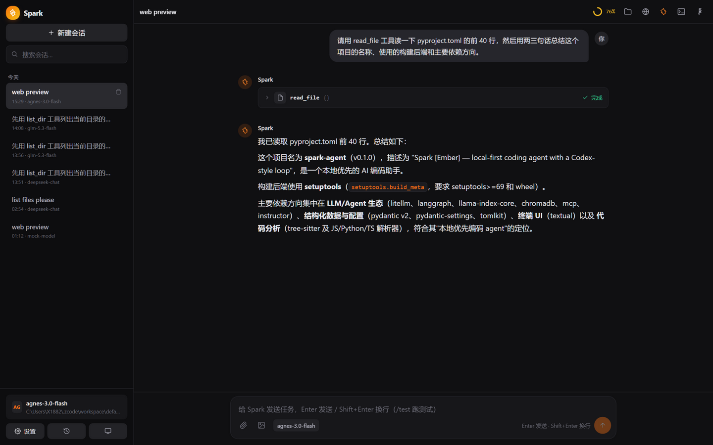
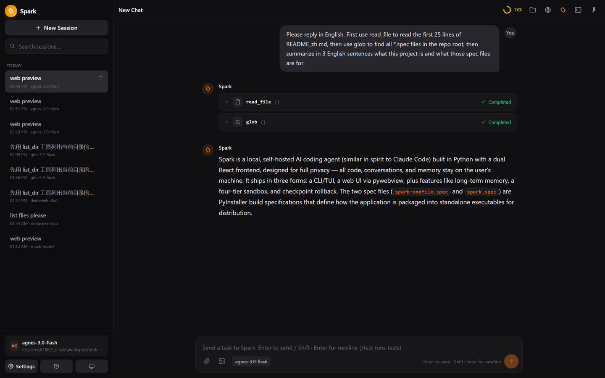
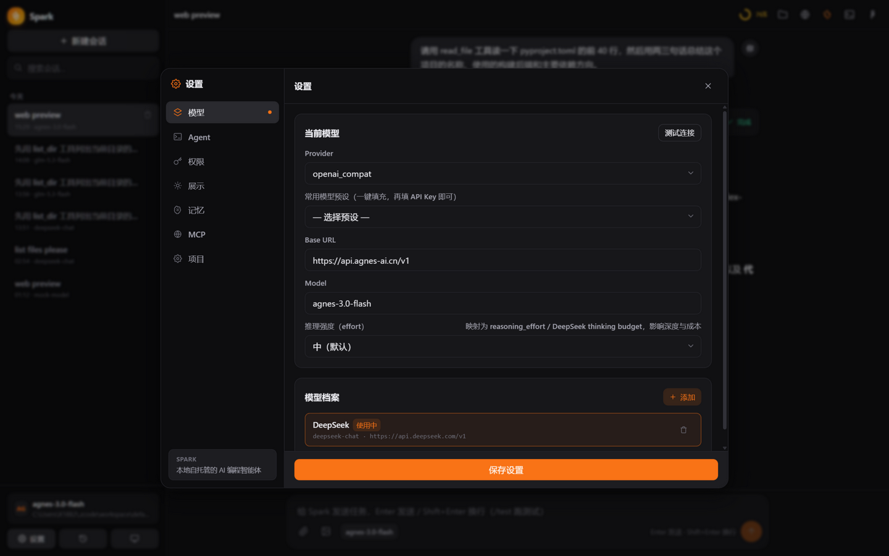
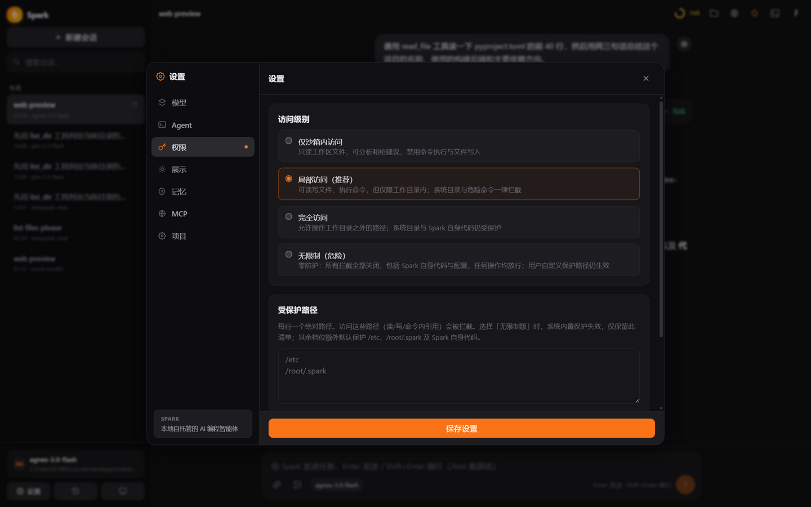
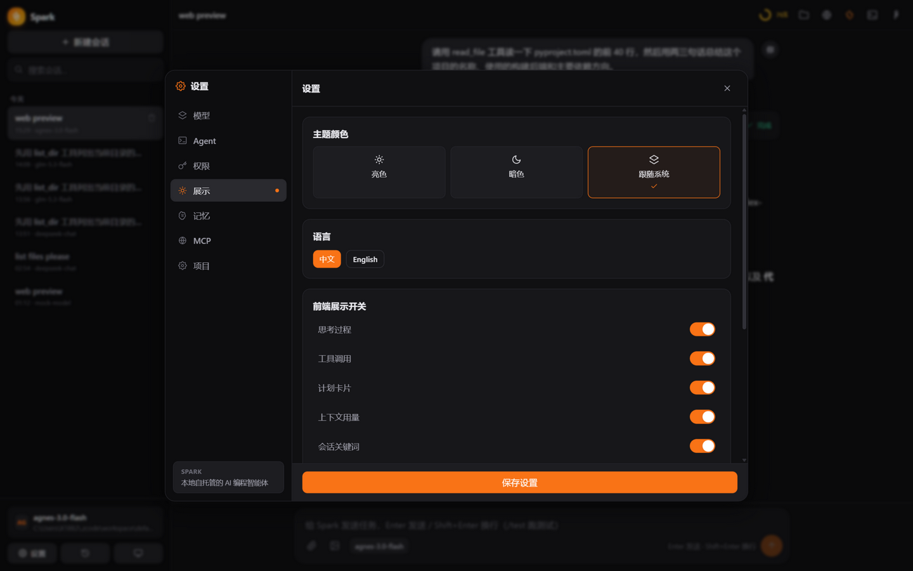
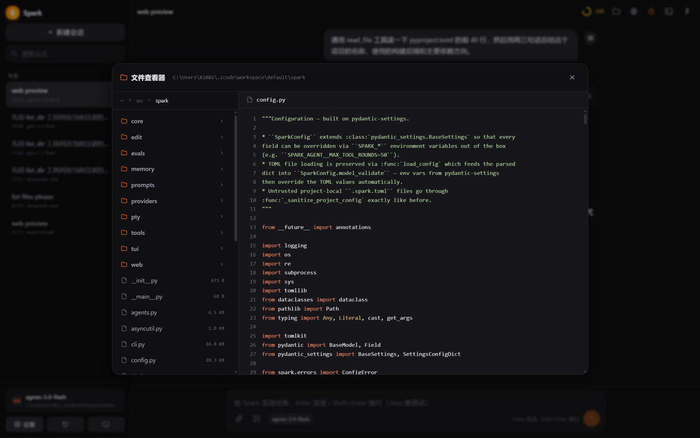
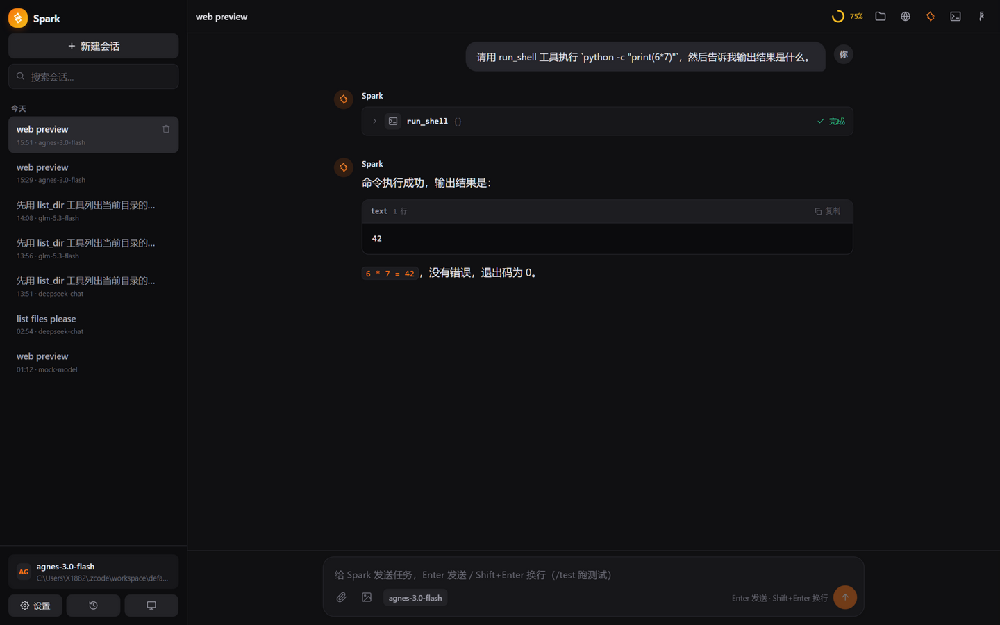

> 🌐 [English](README.md) | [中文](README_zh.md)

# Spark — Local-first AI Coding Agent

[](https://opensource.org/licenses/MIT)
[](https://www.python.org/)
[](https://nodejs.org/)

**Code stays with you. Keys stay with you.** A self-hosted AI coding assistant that runs entirely on your machine — zero privacy leaks, full control.

## Core Values

🔒 **Privacy First** — All code, conversation, and memory data stay entirely local. No third-party servers involved.  
⚡ **Four Form Factors** — Web UI, native desktop window, terminal TUI, and scriptable CLI.  
🧠 **Persistent Memory** — A vector memory store that remembers your project preferences, naming conventions, and workflow habits.  
🔬 **Four-Level Sandbox** — From read-only analysis to full access, tunable by risk profile.  
⏮️ **Checkpoint & Rollback** — Workspace snapshots plus conversation restore — jump to any previous state like Git.

## Preview

### Chat · driven by a real model

> SSE streaming, Markdown code blocks, expandable tool-call cards, live context-usage meter.
> This is a real session: the model read `pyproject.toml` and summarized the project — the `read_file` card shows ✓ Completed.



### English UI · one-click switch

> Built-in Chinese/English localization (Settings → Display → Language). Here the model chained
> `read_file` + `glob` to survey the repo — both tool calls show Completed.



### Settings · models and profiles

> 8 built-in presets (DeepSeek / Qwen / GLM / Kimi / Doubao / Agnes / Ollama / custom),
> multiple saved model profiles with one-click switching, a `Test connection` probe, and three reasoning-effort levels.



### Settings · permissions and sandbox

> Four access levels: sandbox-only / workspace (recommended) / full-access / unrestricted,
> each with an explicit behavior description. The protected-path list is user-editable and defaults to
> `/etc`, `/root/.spark` and Spark's own source tree.



### Settings · display and customization

> Light/dark/system theme, six display toggles (thinking / tools / plan card / context usage /
> session keywords / notices), and a **fully customizable system prompt** (empty = built-in default).



### File viewer · syntax highlighting

> Browse the workdir tree and preview files with line numbers and highlight.js syntax highlighting
> (including correct coloring of multi-line tokens), file sizes, and graceful handling of binary/oversized files.



### Windows EXE · no install required

> Packaged with PyInstaller as a single executable (`dist/spark.exe`) — double-click to run, no Python needed.
> Shown here: the model really invoked `run_shell`, read back the output `42`, and reported the exit code correctly.



## Quick Start

```bash
git clone https://gitcode.com/badhope/spark        # 或 GitHub: https://github.com/badhope/spark
cd spark && python3 -m venv .venv && source .venv/bin/activate   # Windows: .venv\Scripts\activate
pip install -e ".[dev]"
spark web --workdir /your/project
```

Open the printed address in your browser. **Without an API key Spark starts in demo mode (mock);
paste a key into the web settings and it switches to the real model immediately — no restart.**

Windows users can also build a portable EXE (Python 3.11+):

```powershell
powershell -ExecutionPolicy Bypass -File scripts/build-windows.ps1
dist\spark\spark.exe web                    # or just double-click dist\spark.exe
```

## Four Form Factors

| Form | Command | Use case |
|------|---------|----------|
| Web UI | `spark web` | Everyday chat, file viewer, terminal, execution graph (auto-picks a free port) |
| Desktop | `spark desktop` | Native window via pywebview, bound to loopback |
| Terminal TUI | `spark` | Pure terminal environments, remote SSH |
| CLI / scripts | `spark exec "task"` | Automation, CI, piping |
| IDE (ACP) | `spark acp` | Run as an ACP agent inside Zed and other editors (see [docs/ACP.md](docs/ACP.md)) |
| MCP server | `spark mcp-serve` | Expose every built-in tool to other MCP clients |

## Feature Overview

| Category | Features |
|----------|----------|
| Chat | SSE streaming, Markdown code blocks, image attachments, reasoning stream display |
| Tools | File read/write, apply_edit with AST syntax gate, grep/glob, shell, background jobs, Jupyter, web search/fetch, full Git suite, worktrees |
| Planning | Multi-step plans (PlanCard visualization), parallel sub-agent delegation (up to 4), declarative sub-agents (`.claude/agents/*.md`) |
| Approval | Six approval modes (incl. plan-only / approve-plan), `[[permissions]]` wildcard rule engine, three-way approval dialog |
| Permissions | Four-level sandbox, protected paths, credential-path protection, token-level shell checks, MCP least-privilege allowlists |
| Memory | AGENTS.md injection, vector long-term memory (embeddings + optional reranker), auto-extraction, web-based management |
| Persistence | Sessions, checkpoint rollback (works without git), hot config reload, token usage stats |
| Models | Any OpenAI-compatible endpoint, local Ollama, multi-profile switching, `spark test` probe |
| Extension | MCP client (stdio/SSE/HTTP + OAuth), MCP registry search (with China-availability ratings), project skills `.spark/skills/`, lifecycle hooks |
| UI | Chinese/English, light/dark themes, command palette (Ctrl+K), file viewer, built-in terminal, web reader, execution graph, checkpoint panel |

## Architecture


Detailed architecture → [docs/ARCHITECTURE.md](docs/ARCHITECTURE.md)

## Platform Requirements

- Python 3.11+
- Node.js 18+ (frontend development only; the bundled frontend ships prebuilt)
- Any OpenAI-compatible API (DeepSeek, OpenAI, Ollama, Azure, Agnes, Unisound, SenseNova, …)
- Windows / macOS / Linux (one-click EXE build on Windows)

## Documentation

| Document | Contents |
|----------|----------|
| [docs/INSTALL.md](docs/INSTALL.md) | Install & packaging (incl. Windows EXE) |
| [docs/CONFIGURATION.md](docs/CONFIGURATION.md) | Configuration reference (config.toml / env vars / API overview) |
| [docs/API.md](docs/API.md) | HTTP API and SSE event protocol |
| [docs/ARCHITECTURE.md](docs/ARCHITECTURE.md) | Architecture notes |
| [docs/competitive-comparison.md](docs/competitive-comparison.md) | Feature comparison vs Qoder / ZCode / opencode / Codex CLI |

## Community

- Contributing: [CONTRIBUTING.md](CONTRIBUTING.md)
- Issue Tracker: use the **Issues** tab of this repository

---

**License:** MIT · **Author:** badhope · **Built with ❤️ in Shenzhen**
