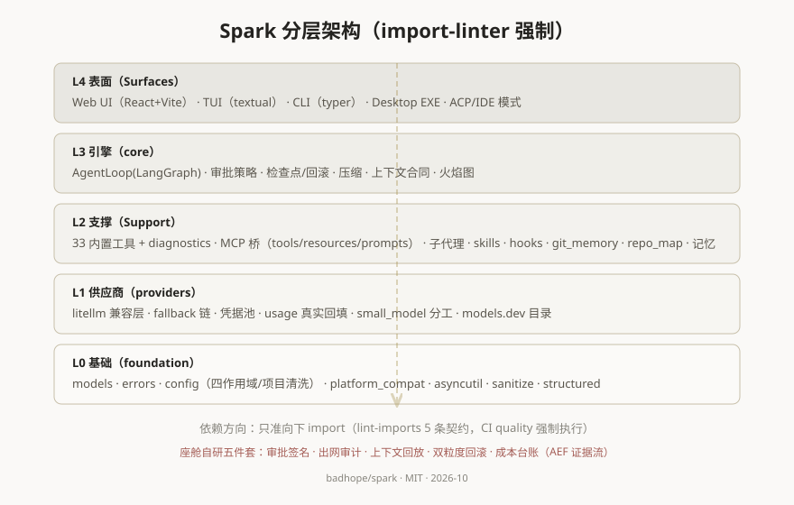
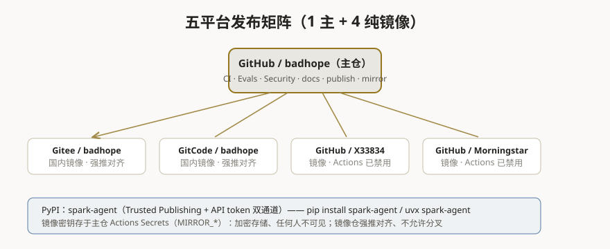
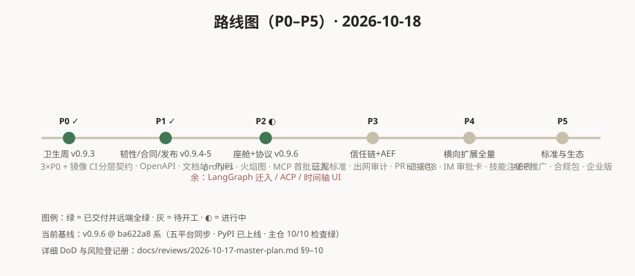

# 图表与运维手册索引

## 图表

| 图 | 内容 |
|---|---|
|  | **分层架构**：L0 基础 → L1 供应商 → L2 支撑 → L3 引擎 → L4 表面，依赖方向由 import-linter 5 条契约在 CI 强制 |
|  | **发布矩阵**：1 主仓 + 4 纯镜像（强推对齐），PyPI 双通道，密钥存于 Actions Secrets |
|  | **P0–P5 路线图**：已完成/进行中/待开工一目了然，详细 DoD 见 master-plan §9–10 |

## 运维手册（密钥与自动化）

### 密钥安放（你问的"远程仓库那个地方"）

GitHub 仓库 **Settings → Secrets and variables → Actions** 就是那个地方：
加密存储，**任何人（包括管理员）都只能覆盖、不能查看内容**，只有 Actions 工作流运行时能读取。

| Secret 名（主仓 badhope/spark） | 用途 | 指向 |
|---|---|---|
| `MIRROR_GITEE_TOKEN` | 镜像推送 Gitee | Gitee/badhope |
| `MIRROR_GITCODE_TOKEN` | 镜像推送 GitCode | GitCode/badhope |
| `MIRROR_GH_X33834_TOKEN` | 镜像推送 | GitHub/X33834 |
| `MIRROR_GH_MORNINGSTAR_TOKEN` | 镜像推送 | GitHub/Morningstar202604 |
| `PYPI_API_TOKEN` | PyPI 发布 | pypi.org spark-agent |

**轮换/恢复流程**：任一 token 泄露或过期 → 到对应平台重新生成 → Settings 里覆盖同名字段即可，代码零改动。

本地 `.env` 模板（新机器恢复推送能力用，自行填入各平台的 token）：

```bash
GH_BADHOPE_TOKEN=ghp_xxx
GITCODE_TOKEN=xxx
GITEE_TOKEN=xxx
GH_X33834_TOKEN=ghp_xxx
GH_MORNINGSTAR_TOKEN=ghp_xxx
PYPI_TOKEN=pypi-xxx
```

### 自动化流水线（全部已验证绿）

| 工作流 | 触发 | 作用 |
|---|---|---|
| `ci.yml` | push main | quality(ruff/mypy/import-linter/bandit) + test 矩阵(3.11/3.12) + evals |
| `mirror.yml` | push main / tags | 主仓 → 4 镜像强推同步（分支+标签） |
| `publish.yml` | tag `v*` | 构建 sdist/wheel → 版本查重 → 发布 PyPI |
| `docs.yml` | docs 变更 | mkdocs-material 自动部署 GitHub Pages |
| `release.yml` | release published | 三平台 EXE 构建并上传 Release |
| `security.yml` | push | secret-scan + dependency-audit |

### 发版 SOP（4 步）

1. 三处版本号一致：`pyproject.toml` / `src/spark/__init__.py` / `uv.lock` + CHANGELOG
2. 全量测试 + 四门槛本地过（ruff / mypy / lint-imports / bandit）
3. `bash spark_push.sh`（五平台一键；4 镜像为强推）
4. `git tag v<版本> && git push <主仓> v<版本>` → PyPI + Release 自动发布

### 镜像纪律

- 4 个镜像仓**不允许本地提交**（会被强推覆盖）；X33834/Morningstar 的 Actions 与 Dependabot 已通过 API 禁用
- 镜像上的依赖更新在主仓完成后随镜像同步下发
